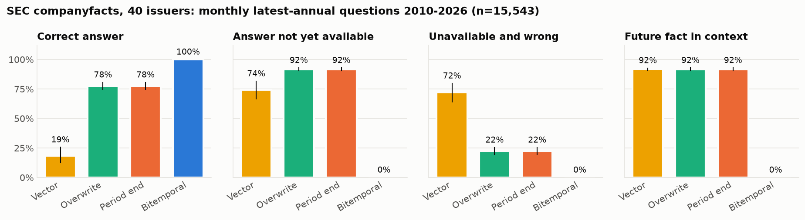
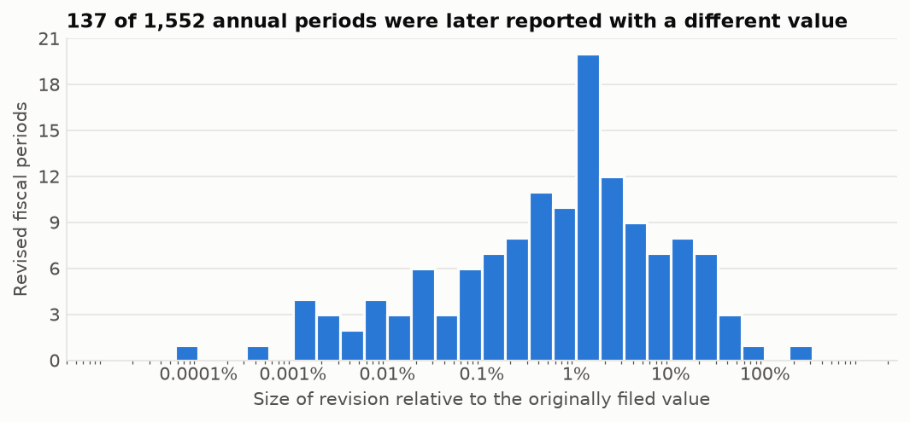
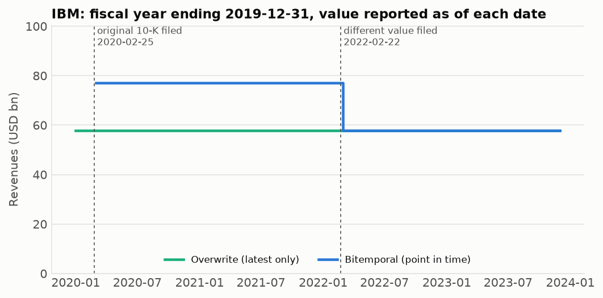
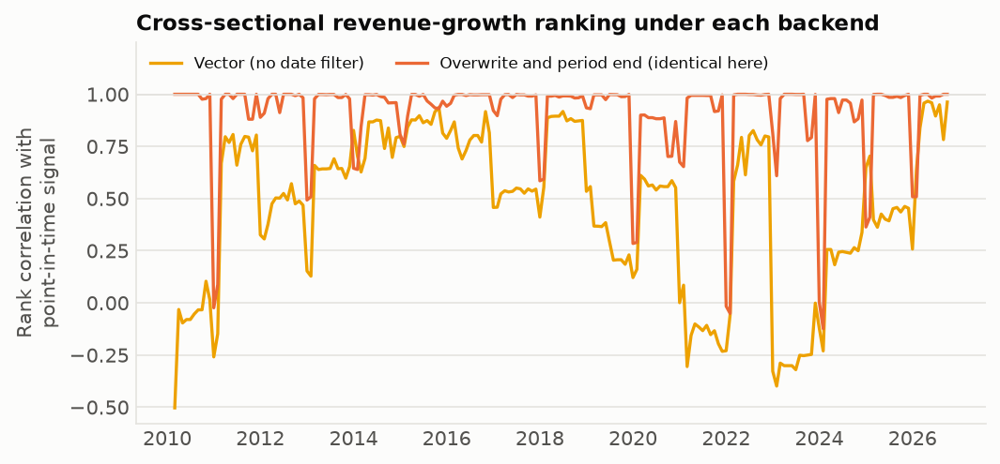
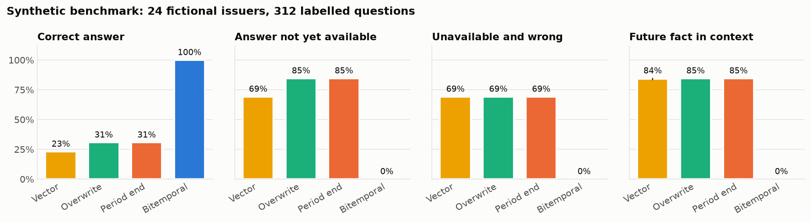
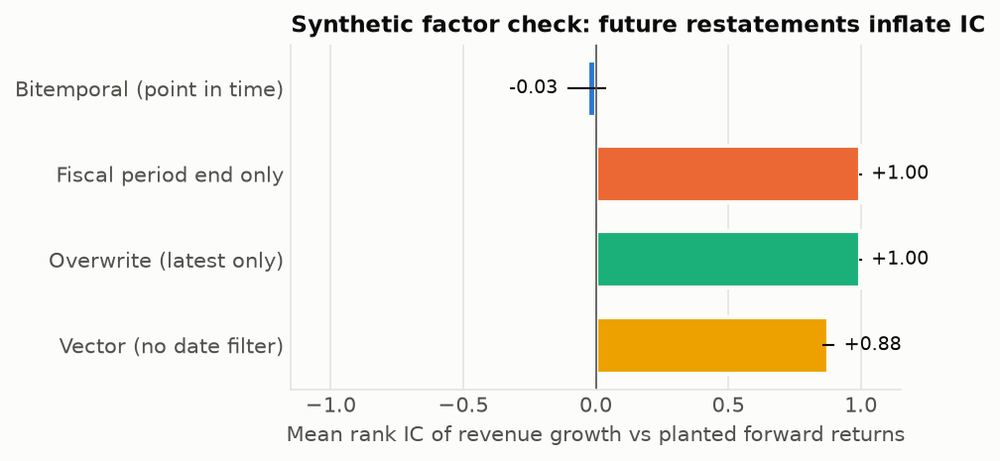
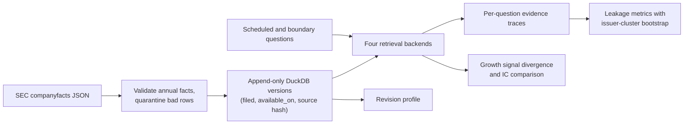

# Point-in-Time Agent Memory

[](https://github.com/wcsmars/Point-in-Time-Agent-Memory/actions/workflows/tests.yml)

A bitemporal fact store for financial research agents, and an audit of how much
future information ordinary retrieval lets into an agent's memory.

When an LLM research agent backtests an idea "as of March 2021", every number it
retrieves must have been public in March 2021. Vector stores and "latest value"
caches do not know that. A company's 2019 revenue can be filed in February 2020
and recast two years later; a store that keeps only the newest value, or
filters only on the fiscal period, silently answers 2020 questions with 2022
knowledge. This project stores every filing-level version of each SEC fact with
two dates, retrieves exactly what was available on the query date, exposes that
as a tool an agent can call, and measures how often four retrieval designs leak,
using 40 issuers' real SEC filings.

Terms used below: a **CIK** is the SEC's company identifier; **XNYS** is the New
York Stock Exchange trading calendar; **IC** (information coefficient) is the
rank correlation between a signal and later returns.

## Results on real SEC filings

40 large US issuers, 245,551 filing-level annual facts from SEC EDGAR
companyfacts, four predeclared income-statement concepts (3,951 facts). Each
series was asked "what is the latest annual value?" on the first day of every
month from its first filing through October 2026. A month is skipped when the
point-in-time answer's fiscal year ended more than 550 days earlier, which
removes tags an issuer has stopped using: **15,543 questions** per backend. In
this audit the point-in-time answers are served by DuckDB SQL. Intervals are
95% bootstrap intervals that resample issuers (10,000 draws).



| Backend | Correct | Answer not yet available | Unavailable **and** wrong | Future fact in context |
| --- | --- | --- | --- | --- |
| Vector, no date filter | 18.6% [12.4, 25.6] | 74.2% [66.4, 81.5] | 72.1% [64.1, 79.8] | 91.8% |
| Overwrite (latest value only) | 77.7% [74.6, 80.6] | 91.7% [90.4, 92.9] | 22.3% [19.4, 25.4] | 91.7% |
| Filter on fiscal period end only | 77.7% [74.6, 80.6] | 91.7% [90.4, 92.9] | 22.3% [19.4, 25.4] | 91.7% |
| Bitemporal (this project) | 100% * | 0% | 0% | 0% |

\* Correct by construction: the expected answers come from an independent
implementation of the same availability rule. The row verifies the SQL against
that rule; it is not evidence that the rule captures every channel of
information (see Limitations). The vector baseline ranks by lexical overlap
between the question text (which includes the dates) and each fact's text. Its
numbers show what happens with no time filter at all; they are not a benchmark
of production embedding models.

The overwrite and period-end stores always select the same answer: both take
the newest filing of the newest fiscal period that has ended. They are kept
apart because they fail differently. The period-end store still holds every
version and becomes correct once an availability filter is added; the
overwrite store has discarded the original values, so no later filter can
recover them.

What the 14,257 answers of the period-end store that were not yet available
contained (`leaked_answer_breakdown` in
[`study.json`](examples/results/study.json)):

- **10,793 repeated the right number from a later filing.** Each 10-K reports
  the two prior years again as comparatives, so the newest copy of a value
  usually comes from a report that did not exist on the question date. The
  number is right; the citation is from the future, and an audit trail built
  on it fails.
- **2,243 described a newer fiscal year that was not yet available.** Between
  a fiscal year end and its filing (median 51 days here), a period-end filter
  serves the new year's numbers early. For 2,177 of them the 10-K had not been
  filed; the other 66 were filed on the question date or were still waiting
  for the next trading session.
- **1,221 were later restated values** for the right year.

### How often SEC values change after first publication



Of 1,552 annual periods, 1,302 appear again in a later filing and **137 (8.8%)
were later reported with a different value**, at 24 of the 40 issuers. About
half of the changes (68) exceed 1% of the original value; the 90th percentile
is 16%. The smallest are rounding, when a later 10-K reports the same year in
millions instead of thousands. The
median time from the original 10-K to the first different value is 367 days,
which is the next annual report. By date and size, the largest changes
coincide with publicly known events: recasts after separations (Abbott after
AbbVie, IBM after Kyndryl, Pfizer after Upjohn) and revenue-recognition
standards adopted retrospectively (Apple's amended 2009 10-K, Microsoft and
Salesforce under ASC 606). The causes were matched to those events, not read
from the filings. Every changed period is listed with both accession numbers in
[`examples/results/revisions.csv`](examples/results/revisions.csv), so each case
can be traced to its filings. IBM's 2019 revenue:



IBM filed $77.1bn for 2019 in February 2020. The February 2022 10-K, after the
Kyndryl separation, reported $57.7bn for the same year. A latest-value store
shows $57.7bn on every date, including two years in which nobody could have
known it.

### Effect on a factor signal

The same code computes annual revenue growth for each issuer and month under
every backend (33 issuers report `us-gaap:Revenues`; 202 monthly dates;
issuer-months whose latest point-in-time year is more than 550 days old are
dropped from all backends). No returns are involved, so this isolates
contamination of the signal itself. This part uses the in-memory
implementation of every backend, which the tests check against the SQL.



| Backend | Signals changed vs point in time | Signals without a point-in-time counterpart | Mean (min) per-date rank correlation |
| --- | --- | --- | --- |
| Vector | 83.5% of 4,600 | 804 | 0.46 (-0.50) |
| Overwrite / period end | 27.0% of 4,635 | 206 | 0.91 (-0.12) |

Missing counterparts mean the point-in-time backend could not compute a signal
for that issuer and date. All such signals in this study used unavailable facts;
the report also records unavailable-fact use separately.

More than a quarter of the latest-value growth signals differ from what was
knowable. On six of the January and February dates (when most fiscal years
have ended but few 10-Ks are filed) the period-end store's ranking had a rank
correlation between -0.12 and 0.09 with the point-in-time ranking. A backtest
built on such a store trades on rankings that never existed.

### Synthetic benchmark and factor check

A fully labelled offline fixture (24 fictional issuers, each asked 13
handwritten questions covering exchange holidays, filing days, amendments and
a newly filed restatement of an older year; 312 in all) runs in CI without
any download. Its forward returns are deliberately correlated with future
restatements, which checks that the IC comparison detects look-ahead: the leaky
backends show a mean rank IC of +0.88 to +1.00 over the fixture's four dates,
while the point-in-time signal shows -0.03.

<p>


</p>

The synthetic IC numbers are a regression fixture, not an empirical estimate.

## How it works

**Two dates per fact.** Each value keeps its fiscal period (`period_start`,
`period_end`), the SEC filing date (`filed`), and `available_on`: the first
NYSE trading session strictly after the filing date, from a holiday-aware
exchange calendar. Companyfacts gives no acceptance time, so filing-day use is
excluded conservatively. A filing on the Friday before Presidents' Day becomes
available on Tuesday.

**Append-only versions.** Later filings add rows; nothing is updated in place.
A stable content hash makes repeated imports idempotent, and every row links to
its filing index on sec.gov and the SHA-256 of the downloaded source file.

**Retrieval order.** For a question about CIK, concept and unit as of a date:

1. keep facts with `available_on <= as_of` and `period_end <= as_of`;
2. take the newest eligible fiscal period (or the requested one);
3. within it, take the newest eligible filing;
4. if that filing date carries conflicting values, abstain as `ambiguous` and
   return all candidates; if nothing is eligible, abstain as `not_known`.

Step 2 runs before step 3 on purpose: a single as-of join over all periods would
let a restatement of an old year displace the newest year.

```sql
SELECT * FROM facts
WHERE cik = ? AND concept = ? AND unit = ? AND available_on <= ? AND period_end <= ?
QUALIFY dense_rank() OVER (ORDER BY period_end DESC, filed DESC) = 1
```

**Four backends, one interface.**

| Backend | Representation | Deliberate weakness |
| --- | --- | --- |
| `vector` | 512-dimension signed feature-hash vectors, cosine top 5 | No date filter at all |
| `overwrite` | One newest-filing snapshot per fiscal year, built once | History is gone; fiscal end is the only date filter |
| `period_end` | All versions, filtered by fiscal period end | Treats period end as publication |
| `bitemporal` | All versions, filtered by availability first | Reference implementation |

The vector baseline is a deterministic lexical vector space, not a semantic
embedding model; it isolates the effect of having no time filter without any
API cost. All backends share exact CIK, concept and unit scoping, so the
comparison measures temporal behavior, not entity resolution.

**Evidence, not judgment.** Each question records the expected answer, the
selected fact, the full retrieved context with citations, latency and leakage
flags. Metrics carry numerators and denominators. A correct number does not
excuse a future citation, and a future fact in the context is reported even
when the selected answer is clean.



## Quick start

Python 3.11 or newer. The package is `pit_memory` and the command is
`pit-memory`.

```bash
git clone https://github.com/wcsmars/Point-in-Time-Agent-Memory.git
cd Point-in-Time-Agent-Memory
python3.11 -m venv .venv && source .venv/bin/activate
python -m pip install -e '.[dev,plots]'
python -m pytest
```

Offline, no downloads. The bundled sample holds 834 real SEC facts for eight
issuers chosen because their filings contain restatements, so its revision
rate (18% of periods) and the latest-value stores' wrong-answer rates are
higher than in the 40-issuer results above.

```bash
pit-memory demo --output runs/demo                  # synthetic benchmark + factor check
pit-memory import-facts examples/sample-data/sec-facts-sample.jsonl --db data/sample.duckdb
pit-memory query --db data/sample.duckdb --cik 51143 --concept us-gaap:Revenues \
  --as-of 2021-03-15 --period-end 2019-12-31        # IBM 2019 revenue as known in March 2021
pit-memory study --db data/sample.duckdb --universe examples/universe.txt --output runs/sample-study
pit-memory plot --study runs/sample-study --demo runs/demo --output runs/figures
```

`./run-demo.sh` runs the synthetic demo straight from the source tree, without
installing anything.

Full study from SEC (about two minutes to download and import 40 issuers; the
client stays below SEC's request-rate limit and asks for compressed responses).
SEC requires a descriptive User-Agent with a real contact address:

```bash
export SEC_USER_AGENT='YourProjectName your-real-contact@example.org'
pit-memory fetch-sec --ciks-file examples/universe.txt --db data/sec.duckdb --cache data/raw
pit-memory study --db data/sec.duckdb --universe examples/universe.txt \
  --start 2010-01-01 --end 2026-10-01 --max-age-days 550 --output runs/sec-study
pit-memory plot --study runs/sec-study --output figures
```

Other commands: `evaluate` (boundary-enriched audit around every filing date;
pass `--concept`),
`factor` (rank IC against a returns CSV you supply), `import-sec` (downloaded
companyfacts files), `export-facts`. Add `--backend overwrite` (or `vector`,
`period_end`) to `query` to see what a leaky store would have said.
`pit-memory <command> --help` lists the options and defaults.

### As an agent tool

`pit_memory.agent_tool` defines the lookup as a JSON Schema tool (name,
description, parameters) for a function-calling LLM, and a handler that turns
the model's arguments into a cited answer or an explicit abstention. APIs
wrap tool definitions differently, so `input_schema_tool()`, `function_tool()`
and `flat_function_tool()` return the same definition in the three common
layouts. The agent
passes its simulated knowledge date as `as_of`; the tool cannot return anything
published later.

```python
from pit_memory import DuckDBStore
from pit_memory.agent_tool import TOOL_SPEC, call_tool

# Register TOOL_SPEC (or one of the layouts above) with the agent; when the
# model calls it, run (read-only: a missing database is an error, and several
# agent processes can share the file):
with DuckDBStore("data/sample.duckdb", read_only=True) as store:
    result = call_tool({"cik": "51143", "concept": "us-gaap:Revenues",
                        "as_of": "2021-03-15", "period_end": "2019-12-31"}, store.retrieve)
print(result["status"], result["fact"]["value"], result["fact"]["accession"])
# known 77147000000.0 0001558370-21-001489
# (the February 2021 10-K, which repeated the original figure; the $57.7bn recast
#  filed in 2022 is invisible on this date)
```

The result carries the status (`known`, `not_known`, `ambiguous`), the value
with its fiscal period, form, accession, filing and availability dates and a
link to the filing, or every conflicting candidate when the answer is
ambiguous. Malformed arguments return `{"status": "error", ...}` so the model
can correct its call. The handler also rejects evidence outside the requested
issuer, concept, unit, period or cutoff, even if an incompatible retriever is supplied.

## Repository layout

```
src/pit_memory/
  models.py       Fact, Query, Retrieval: validated, immutable, content-hashed
  calendar.py     first XNYS session after a filing date (exchange_calendars)
  sec.py          companyfacts parser and rate-limited, caching SEC client
  store.py        append-only DuckDB store and point-in-time SQL retrieval
  backends.py     vector, overwrite, period-end and bitemporal retrievers
  evaluation.py   boundary and scheduled questions, independent oracle, metrics, bootstrap
  factor.py       revenue-growth signal, tie-aware Spearman IC, paired IC differences
  study.py        revision profile, scheduled audit, signal divergence
  agent_tool.py   JSON Schema tool definition and handler for an LLM agent
  plots.py        figures in this README
  demo.py         labelled synthetic fixture
  cli.py          pit-memory command line
tests/            295 tests: dates, holidays, restatements, SQL, CLI, cross-checks
docs/             architecture and full evaluation specification
examples/         universe, SEC sample data, study outputs
figures/          charts above
```

Methodology details, metric definitions and the factor protocol are in
[docs/evaluation.md](docs/evaluation.md) and
[docs/architecture.md](docs/architecture.md).

## Validation

- 295 tests include real exchange-calendar sessions (Good Friday, Hurricane
  Sandy and national days of mourning, year boundaries), DuckDB transactions
  and idempotent re-imports, ambiguity on same-day conflicts, rank ties,
  matched-cohort IC pairing, issuer-cluster bootstrap intervals, SEC retries,
  rate limiting, compressed and dropped connections and damaged caches (mocked
  network), the bundled real SEC sample, strict agent-tool argument and
  evidence checks, and output paths that cannot overwrite their own inputs or
  database.
- The tests were themselves tested: 170 single-line mutations of the core
  logic (date filters, ranking, ambiguity, scoring, bootstrap, revision and
  signal bookkeeping, ingestion scope) were planted one at a time. The suite
  catches 147 of the 156 that still apply to the code. Eight of the other nine
  cannot change behavior (for example, removing a date check that the fact
  model already guarantees); one changes only a per-row trace field.
- A randomized cross-check (`tests/test_crosscheck.py`) runs 9,000 queries on
  the SEC sample and on stress corpora of restatements, same-day conflicts,
  shifted fiscal-year starts, repeated rows and signed zeros. DuckDB SQL, the in-memory backend and a second
  in-memory implementation must agree with a brute-force reading of the rule on
  every query.
- For this release the full 40-issuer database was also re-derived from the raw
  SEC files with separately written code (245,551 rows, no differences), every
  filing date's availability session was recomputed, and the headline numbers
  above were recomputed from scratch.
- CI runs the tests on Python 3.11 to 3.13, the synthetic demo, the study on the
  SEC sample, and the plots. It also builds a wheel, installs it in a separate
  environment and, from outside the source tree, runs the demo and answers the
  IBM question above from the imported sample.

## Limitations

- **Universe.** 40 of today's large firms, hand-picked on 23 October 2026. It
  is not survivorship-free, and rates depend on the monthly question schedule;
  they are not estimates of leakage in the wider market.
- **Source.** Companyfacts is a retrospective aggregation, not an archive of
  every historical API snapshot. Earnings releases often precede the 10-K, so
  "unavailable" means unavailable in this SEC source, not unknown to the market.
  The date-only convention ignores intraday acceptance times.
- **Scope.** Annual duration facts only; no quarterly or balance-sheet facts,
  no harmonization across revenue tags, no prices. The factor experiment
  measures signal contamination and IC with supplied returns; it is not a
  trading strategy or a performance claim.
- **Attribution.** A future fact in retrieved context proves retrieval
  exposure. A model answer containing a value absent from its context could
  come from training data, a guess or another tool; this project does not
  measure model-training leakage.

## License

MIT. SEC EDGAR data is public; see SEC's
[access guidance](https://www.sec.gov/about/webmaster-frequently-asked-questions).
