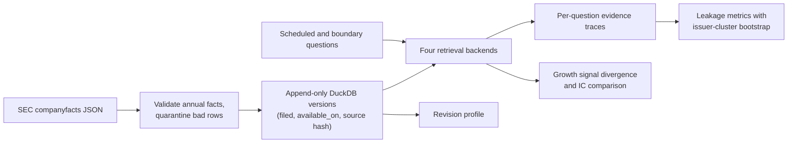

# Point-in-Time Agent Memory

[](https://github.com/wcsmars/Point-in-Time-Agent-Memory/actions/workflows/tests.yml)

A bitemporal fact store for financial research agents, and an audit of how much
future information ordinary retrieval lets into an agent's memory.

When an LLM research agent backtests an idea "as of March 2021", every number it
retrieves must have been public in March 2021. Vector stores and "latest value"
caches do not know that. A company's 2019 revenue can be filed in February 2020
and recast two years later; a store that keeps only the newest value, or
filters only on the fiscal period, silently answers 2020 questions with 2022
knowledge. This project stores every filing-level version of each SEC fact with
two dates, retrieves exactly what was available on the query date, and measures
how often four retrieval designs leak, using 40 issuers' real SEC filings.

## Results on real SEC filings

40 large US issuers, 245,551 filing-level annual facts from SEC EDGAR
companyfacts, four predeclared income-statement concepts (3,951 facts). Each
series was asked "what is the latest annual value?" on the first day of every
month from its first filing through October 2026, while the series was still
being reported (the point-in-time answer at most 550 days past its fiscal year
end): **15,543 questions** per backend. In this audit the point-in-time answers
are served by DuckDB SQL. Intervals are 95% bootstrap intervals that resample
issuers.


| Backend | Correct | Answer not yet available | Unavailable **and** wrong | Future fact in context |
| --- | --- | --- | --- | --- |
| Vector, no date filter | 18.6% [12.7, 25.2] | 74.2% [67.3, 80.9] | 72.1% [64.8, 79.4] | 91.8% |
| Overwrite (latest value only) | 77.7% [74.4, 80.7] | 91.7% [90.5, 93.1] | 22.3% [19.3, 25.6] | 91.7% |
| Filter on fiscal period end only | 77.7% [74.4, 80.7] | 91.7% [90.5, 93.1] | 22.3% [19.3, 25.6] | 91.7% |
| **Bitemporal (this project)** | **100%** | **0%** | **0%** | **0%** |

On this latest-value schedule the overwrite and period-end stores pick the same
fact by construction. They differ in what is left afterwards: the overwrite
store has discarded the original values, so no later date filter can repair it.

What the 14,257 answers of the period-end store that were not yet available
contained:

- **10,793 repeated the right number from a later filing.** Each 10-K reports
  the two prior years again as comparatives, so the newest copy of a value
  usually comes from a report that did not exist on the question date. The
  number is right; the citation is from the future, and an audit trail built
  on it fails.
- **2,243 described a fiscal year whose 10-K had not been filed.** Between a
  fiscal year end and its filing (median 51 days here), a period-end filter
  serves the new year's numbers early.
- **1,221 were later restated values** for the right year.

The bitemporal backend matches an independent reference scan on every
question. That verifies the SQL implementation against the stated availability
rule; it is not evidence that the rule captures every channel of information
(see Limitations).

### How often SEC values change after first publication


Of 1,561 annual periods, 1,301 appear again in a later filing and **136 (8.7%)
were later reported with a different value**, at 24 of the 40 issuers. Half of
the changes exceed 1% of the original value; the 90th percentile is 16%. The
median time from the original 10-K to the first different value is 367 days,
which is the next annual report. The largest changes in this sample line up
with recasts after separations (Abbott after AbbVie, IBM after Kyndryl, Pfizer
after Upjohn) and with revenue-recognition standards adopted retrospectively
(Apple's amended 2009 10-K, Microsoft and Salesforce under ASC 606). Every
changed period is listed with both accession numbers in
[`examples/results/revisions.csv`](examples/results/revisions.csv), so each
case can be checked against the filings. IBM's 2019 revenue:


IBM filed $77.1bn for 2019 in February 2020. The February 2022 10-K, after the
Kyndryl separation, reported $57.7bn for the same year. A latest-value store
shows $57.7bn on every date, including two years in which nobody could have
known it.

### Effect on a factor signal

The same code computes annual revenue growth for each issuer and month under
every backend (33 issuers report `us-gaap:Revenues`; 202 monthly dates;
issuer-months whose latest point-in-time year is more than 550 days old are
dropped from all backends). No returns are involved, so this isolates
contamination of the signal itself. This part uses the in-memory
implementation of every backend, which the tests check against the SQL.


| Backend | Signals changed vs point in time | Signals that should not exist yet | Mean (min) per-date rank correlation |
| --- | --- | --- | --- |
| Vector | 83.5% of 4,600 | 804 | 0.46 (-0.50) |
| Overwrite / period end | 27.0% of 4,635 | 206 | 0.91 (-0.12) |

More than a quarter of the latest-value growth signals differ from what was
knowable. On six of the January and February dates (when most fiscal years
have ended but few 10-Ks are filed) the period-end store's ranking had a rank
correlation between -0.12 and 0.09 with the point-in-time ranking. A backtest
built on such a store trades on rankings that never existed.

### Synthetic benchmark and factor check

A fully labelled offline fixture (24 fictional issuers, each asked 13
handwritten questions covering exchange holidays, filing days, amendments and
a newly filed restatement of an older year; 312 in all) runs in CI without any download. Its
forward returns are deliberately correlated with future restatements, which
checks that the IC comparison detects look-ahead: the leaky backends show a
mean rank IC near +1.0 while the point-in-time signal shows none.

<p>


</p>

The synthetic IC numbers are a regression fixture, not an empirical estimate.

## How it works

**Two dates per fact.** Each value keeps its fiscal period (`period_start`,
`period_end`), the SEC filing date (`filed`), and `available_on`: the first
NYSE trading session strictly after the filing date, from a holiday-aware
exchange calendar. Companyfacts gives no acceptance time, so filing-day use is
excluded conservatively. A filing on the Friday before Presidents' Day becomes
available on Tuesday.

**Append-only versions.** Later filings add rows; nothing is updated in place.
A stable content hash makes repeated imports idempotent, and every row links to
its filing index on sec.gov and the SHA-256 of the downloaded source file.

**Retrieval order.** For a question about CIK, concept and unit as of a date:

1. keep facts with `available_on <= as_of` and `period_end <= as_of`;
2. take the newest eligible fiscal period (or the requested one);
3. within it, take the newest eligible filing;
4. if that filing date carries conflicting values, abstain as `ambiguous` and
   return all candidates; if nothing is eligible, abstain as `not_known`.

Step 2 runs before step 3 on purpose: a single as-of join over all periods would
let a restatement of an old year displace the newest year.

```sql
SELECT * FROM facts
WHERE cik = ? AND concept = ? AND unit = ? AND available_on <= ? AND period_end <= ?
QUALIFY dense_rank() OVER (ORDER BY period_end DESC, filed DESC) = 1
```

**Four backends, one interface.**

| Backend | Representation | Deliberate weakness |
| --- | --- | --- |
| `vector` | 512-dimension signed feature-hash vectors, cosine top 5 | No date filter at all |
| `overwrite` | One newest-filing snapshot per period, built once | History is gone; fiscal end is the only date filter |
| `period_end` | All versions, filtered by fiscal period end | Treats period end as publication |
| `bitemporal` | All versions, filtered by availability first | Reference implementation |

The vector baseline is a deterministic lexical vector space, not a semantic
embedding model; it isolates the effect of having no time filter without any
API cost. All backends share exact CIK, concept and unit scoping, so the
comparison measures temporal behaviour, not entity resolution.

**Evidence, not judgement.** Each question records the expected answer, the
selected fact, the full retrieved context with citations, latency and leakage
flags. Metrics carry numerators and denominators. A correct number does not
excuse a future citation, and a future fact in the context is reported even
when the selected answer is clean.



## Quick start

Python 3.11 or newer.

```bash
git clone https://github.com/wcsmars/Point-in-Time-Agent-Memory.git
cd Point-in-Time-Agent-Memory
python -m venv .venv && source .venv/bin/activate
python -m pip install -e '.[dev,plots]'
python -m pytest
```

Offline, no downloads:

```bash
pit-memory demo --output runs/demo                     # synthetic benchmark + factor check
pit-memory study --facts examples/sample-data/sec-facts-sample.jsonl \
  --universe examples/universe.txt --output runs/sample-study   # real SEC sample, 8 issuers
pit-memory plot --study runs/sample-study --demo runs/demo --output runs/figures
```

Full study from SEC (about 20 minutes for 40 issuers at SEC's rate limit). SEC
requires a descriptive User-Agent with a real contact address:

```bash
export SEC_USER_AGENT='YourProjectName your-real-contact@example.org'
pit-memory fetch-sec --ciks-file examples/universe.txt --db data/sec.duckdb --cache data/raw
pit-memory study --db data/sec.duckdb --universe examples/universe.txt \
  --start 2010-01-01 --end 2026-10-01 --max-age-days 550 --output runs/sec-study
pit-memory plot --study runs/sec-study --output figures
```

Other commands: `query` (one cited answer as of a date, from any backend),
`evaluate` (boundary-enriched audit around every filing date), `factor`
(rank IC against a returns CSV you supply), `import-sec`, `export-facts`.
`pit-memory <command> --help` lists the options.

### As an agent tool

```python
from pit_memory import DuckDBStore, Query

with DuckDBStore("data/sec.duckdb") as store:
    answer = store.retrieve(Query("q1", "51143", "us-gaap:Revenues", "USD", as_of="2021-03-15",
                                  period_end="2019-12-31"))
print(answer.status, answer.fact.value, answer.fact.accession, answer.fact.source_url)
# known 77147000000.0 0001558370-21-001489 https://www.sec.gov/Archives/edgar/data/51143/...
# (newest filing available then: the February 2021 10-K, which repeated the original figure)
```

The `Retrieval` object carries the status (`known`, `not_known`, `ambiguous`),
the selected fact and every candidate with its citation, so an agent can quote
its source or abstain instead of guessing.

## Repository layout

```
src/pit_memory/
  models.py       Fact, Query, Retrieval: validated, immutable, content-hashed
  calendar.py     first XNYS session after a filing date (exchange_calendars)
  sec.py          companyfacts parser and rate-limited, caching SEC client
  store.py        append-only DuckDB store and point-in-time SQL retrieval
  backends.py     vector, overwrite, period-end and bitemporal retrievers
  evaluation.py   boundary and scheduled questions, independent oracle, metrics, bootstrap
  factor.py       revenue-growth signal, tie-aware Spearman IC, paired IC differences
  study.py        revision profile, scheduled audit, signal divergence
  plots.py        figures in this README
  demo.py         labelled synthetic fixture
  cli.py          pit-memory command line
tests/            66 tests: hand-checked dates, holidays, restatements, SQL, CLI
docs/             architecture and full evaluation specification
examples/         universe, SEC sample data, study outputs
figures/          charts above
```

Methodology details, metric definitions and the factor protocol are in
[docs/evaluation.md](docs/evaluation.md) and
[docs/architecture.md](docs/architecture.md).

## Validation

- 66 tests, including real exchange-calendar sessions (Good Friday, Hurricane
  Sandy closures), DuckDB transactions and idempotent re-imports, ambiguity on
  same-day conflicts, rank ties, matched-cohort IC pairing, mocked SEC retries
  and caching, and the bundled real SEC sample.
- The bitemporal SQL is checked against an oracle that never calls a backend.
- CI runs the tests on Python 3.11 to 3.13, the synthetic demo, the study on the
  SEC sample, and the plots.

## Limitations

- **Universe.** 40 of today's large firms, hand-picked on 23 October 2026. It
  is not survivorship-free, and rates depend on the monthly question schedule;
  they are not estimates of leakage in the wider market.
- **Source.** Companyfacts is a retrospective aggregation, not an archive of
  every historical API snapshot. Earnings releases often precede the 10-K, so
  "unavailable" means unavailable in this SEC source, not unknown to the market.
  The date-only convention ignores intraday acceptance times.
- **Scope.** Annual duration facts only; no quarterly or balance-sheet facts,
  no harmonisation across revenue tags, no prices. The factor experiment
  measures signal contamination and IC with supplied returns; it is not a
  trading strategy or a performance claim.
- **Attribution.** A future fact in retrieved context proves retrieval
  exposure. A model answer containing a value absent from its context could
  come from training data, a guess or another tool; this project does not
  measure model-training leakage.

## License

MIT. SEC EDGAR data is public; see SEC's
[access guidance](https://www.sec.gov/about/webmaster-frequently-asked-questions).
