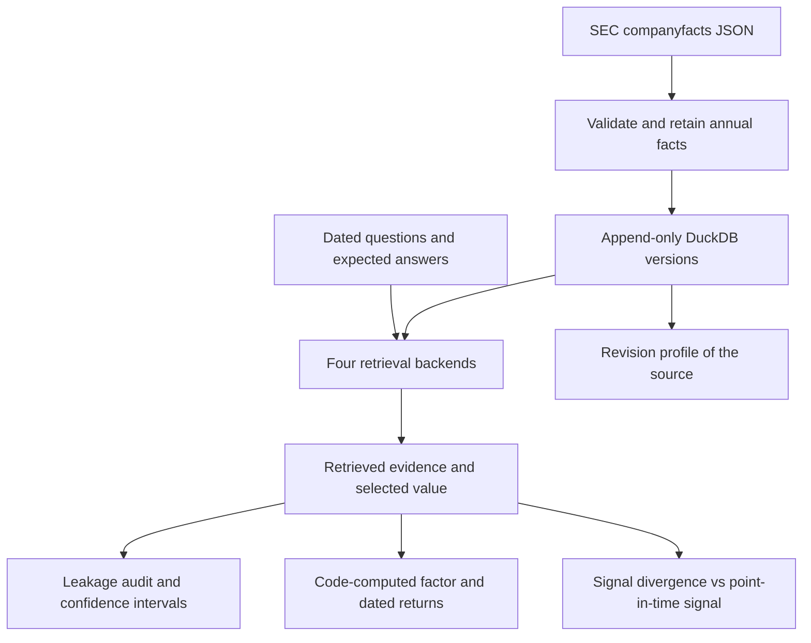

# Architecture and temporal contract

## Identity

A financial series is identified by issuer CIK, namespace-qualified concept, and unit. Annual observations also have a start and end date. Each filing-level value retains its accession, form, filing date, and availability date. A stable digest makes repeat ingestion idempotent. The source digest is provenance; it is not a license to overwrite an earlier filing-level value.

The mutable reality is represented by new rows. There is no API method to update a financial value in place. Direct SQL/file access remains outside this protection. The in-memory implementations apply the same identity: a repeated input row (for example two concatenated exports) counts once, as it does under the database's primary key.

`available_on` is derived from `filed` by the exchange calendar and is part of the digest. If a calendar update (for example a newly announced market closure) changes the computed date of a filing that is already stored, the import is refused rather than adding a second row for the same filing value; rebuild the database from the cached snapshots instead.

## Retrieval order

1. Match CIK, concept, and unit exactly.
2. Require `available_on <= as_of` and `period_end <= as_of`.
3. For an explicit-period query, match that period end. Otherwise select the most recent eligible period end.
4. Within that period, choose the newest eligible filing date.
5. Abstain if the newest filing-date candidates disagree or have incompatible annual starts. Preserve the candidates so the ambiguity is inspectable.

Availability is derived from the exchange calendar, not from `filed + 1 day` or a weekday-only rule. A filing on the day before a market holiday first becomes eligible on the next actual trading session. The date-only convention is conservative and excludes filing-day use.

DuckDB's ASOF JOIN can find the newest observation preceding a query timestamp once the relevant series and fiscal period are resolved. One ASOF over all periods would be wrong: a later comparative filing about an old period must not displace a newer fiscal period. The implementation favors explicit filtering and ranking so period selection and conflict handling remain visible.

## Source policy

Only validated annual duration facts from supported annual forms (10-K, 20-F and 40-F, with their amendments) are included. An annual duration runs 355 to 375 days from start to end: calendar years and 52/53-week years fall inside, while 11- and 13-month fiscal-year transition periods do not, so a growth signal never compares a full year with a partial one. Taxonomy namespaces and currency units stay separate. Malformed annual rows (missing or invalid dates, nonfinite values, malformed accession numbers, a period ending after its filing) are quarantined with their raw row and reason. Out-of-scope rows are counted, by reason, in the import report: other forms, instant facts without a start date, and non-annual periods. Annual-length values filed on other forms, such as recast statements in an 8-K or tables in a proxy statement, are out of scope and reported separately so their number is visible (in the 40-issuer data, 233 such rows fall in the four study concepts). Raw API responses are cached alongside the database for reproduction, with the download time in the cache pointer (and SEC's `Last-Modified` header, if a response carries one).

`filed` represents public-source knowledge time. Import time is a separate operational event; this project reconstructs what the source says had been filed, not what a particular research process had already ingested on a historical date. A production agent would also record its ingestion time and may need a third eligibility constraint for operational replay.

## Audit evidence

Each query records its expected answer, backend-selected fact, retrieved context, citation identifiers, timing, and leakage flags. A correct numeric answer does not excuse future evidence: equal-valued future revisions still constitute exposure under the citation-based availability rule.

The benchmark does not use an LLM judge. Synthetic expected values are created independently of DuckDB retrieval. Real-data cases use the same separate reference routine. It checks the implementation against the rule, not the rule against the filings, so individual cases (the largest revisions in `examples/results/revisions.csv`) were matched to known corporate events (separations and retrospective adoptions of accounting standards). Original filings were not re-read for this release.
