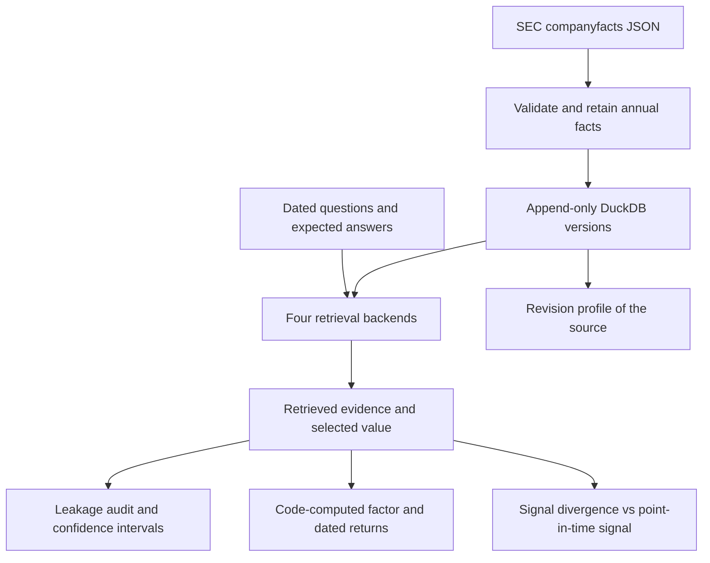

# Architecture and temporal contract

## Identity

A financial series is identified by issuer CIK, namespace-qualified concept, and unit. Annual observations also have a start and end date. Each filing-level value retains its accession, form, filing date, and availability date. A stable digest makes repeat ingestion idempotent. The source digest is provenance; it is not a license to overwrite an earlier filing-level value.

The mutable reality is represented by new rows. There is no API method to update a financial value in place. Direct SQL/file access remains outside this protection.

## Retrieval order

1. Match CIK, concept, and unit exactly.
2. Require `available_on <= as_of` and `period_end <= as_of`.
3. For an explicit-period query, match that period end. Otherwise select the most recent eligible period end.
4. Within that period, choose the newest eligible filing date.
5. Abstain if the newest filing-date candidates disagree or have incompatible annual starts. Preserve the candidates so the ambiguity is inspectable.

Availability is derived from the exchange calendar, not from `filed + 1 day` or a weekday-only rule. A filing on the day before a market holiday first becomes eligible on the next actual trading session. The date-only convention is conservative and excludes filing-day use.

DuckDB's ASOF JOIN can find the newest observation preceding a query timestamp once the relevant series and fiscal period are resolved. One ASOF over all periods would be wrong: a later comparative filing about an old period must not displace a newer fiscal period. The implementation favors explicit filtering and ranking so period selection and conflict handling remain visible.

## Source policy

Only validated annual duration facts from supported annual forms are included. Taxonomy namespaces and currency units stay separate. Missing dates, nonfinite values, invalid intervals, and unsupported rows are recorded as rejected inputs. Raw API responses can be cached alongside the database for reproduction.

`filed` represents public-source knowledge time. Import time is a separate operational event; this project reconstructs what the source says had been filed, not what a particular research process had already ingested on a historical date. A production agent would also record its ingestion time and may need a third eligibility constraint for operational replay.

## Audit evidence

Each query records its expected answer, backend-selected fact, retrieved context, citation identifiers, timing, and leakage flags. A correct numeric answer does not excuse future evidence: equal-valued future revisions still constitute exposure under the citation-based availability rule.

The benchmark does not use an LLM judge. Synthetic expected values are created independently of DuckDB retrieval. Real-data cases use the same separate reference routine. It checks the implementation against the rule, not the rule against the filings, so individual cases (the largest revisions in `examples/results/revisions.csv`) were matched to known corporate events (separations and retrospective adoptions of accounting standards). Original filings were not re-read for this release.
